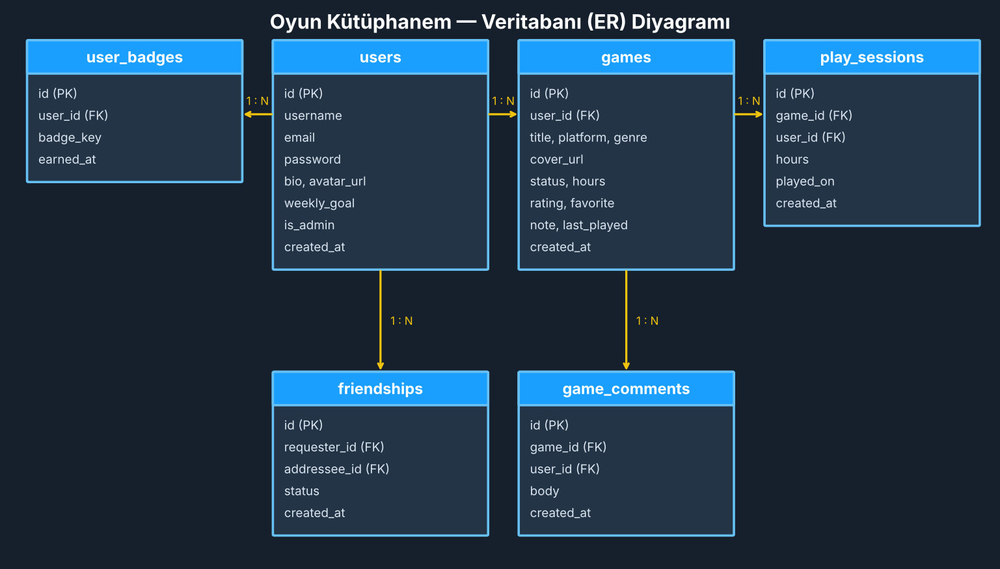

# 🎮 Oyun Kütüphanem

Steam benzeri, oynanan oyunları ve oynama sürelerini takip eden sosyal bir oyun kütüphanesi sitesi.
**İnternet Programcılığı** dersi proje ödevi — PHP (PDO), MySQL/MariaDB, HTML, CSS, JavaScript.

## Özellikler
- Kayıt / giriş, şifre değiştirme, profil sayfası (biyografi, avatar, haftalık hedef)
- Oyun ekleme, düzenleme, silme, arama, filtreleme, sıralama, favoriler, CSV dışa aktarma
- Süre takibi: hızlı “+ saat” girişi ve oyun sayacı (başlat / bitir)
- Arkadaşlık sistemi, oyunlara yorum, etkinlik akışı, liderlik tablosu, “arkadaşların da oynuyor”
- XP / seviye sistemi, 15 rozet, rozet ve seviye bildirimleri, günlük seri
- İstatistikler: oyun takvimi (ısı haritası), aylık grafik, en çok oynananlar
- **Oyun Özetim** (Spotify Wrapped tarzı), Keşfet sayfası, “Ne oynasam?” çarkı
- Demo modu: giriş gerekmeden açılır, otomatik kurulum ve güncelleme, zaman çizelgesi, proje hakkında sayfası
- Arka plan resmi: kendi (anime vb.) resmini yükle ya da adres gir, karartma/bulanıklık ayarla, canlı önizleme (Ayarlar → Görünüm); 4 hazır arka plan
- Profil resmi ve oyun kapağı dosyadan yükleme (güvenli yükleme: MIME + boyut + yeniden kodlama)
- Açılış sayfası, "Kaldığın yerden devam et" bölümü, canlı arama ( / tuşu ), cam (glass) arayüz, animasyonlar
- Oyun tamamlama yüzdesi, özel koleksiyonlar, halka grafikler, rozet ilerleme çubukları
- Steam’den kapak resmi arama, 4 tema, yönetim paneli

## Kurulum (XAMPP) — tek adım
1. XAMPP'ten **Apache** ve **MySQL**'i başlat.
2. Bu klasörü `C:\xampp\htdocs\oyun_kutuphanesi` olarak kopyala.
3. Tarayıcıda `http://localhost/oyun_kutuphanesi/` adresini aç.

Hepsi bu. Veritabanı **otomatik kurulur** (phpMyAdmin'e gerek yok) ve site **demo modunda**,
örnek verilerle, giriş/kayıt istemeden açılır.

- **Demo modu:** `config.php` içindeki `AUTO_LOGIN = true` sayesinde hazır `oyuncu` hesabıyla otomatik girilir.
  Kendi hesabınla denemek için **Çıkış** yapıp **Kayıt Ol**. Gerçek yayında `AUTO_LOGIN` değerini `false` yap.
- Eski sürümden güncellerken de bir şey yapmana gerek yok, eksik tablolar/sütunlar otomatik eklenir.
- Veritabanı şifren varsa `config.php` içindeki `$DB_PASS` değerini değiştir.
- Diğer demo kullanıcılar: `ali_demo`, `ayse_demo`, `mehmet_demo`, `zeynep_demo` — şifre: `demo1234`.

## Güvenlik
PDO hazırlanmış sorgular (SQL injection), `htmlspecialchars` ile çıktı süzme (XSS), CSRF token,
`password_hash` ile şifre saklama, oturum yenileme ve yetki kontrolleri.

## Veritabanı

Daha fazla bilgi: [SUNUM_REHBERI.md](SUNUM_REHBERI.md)
